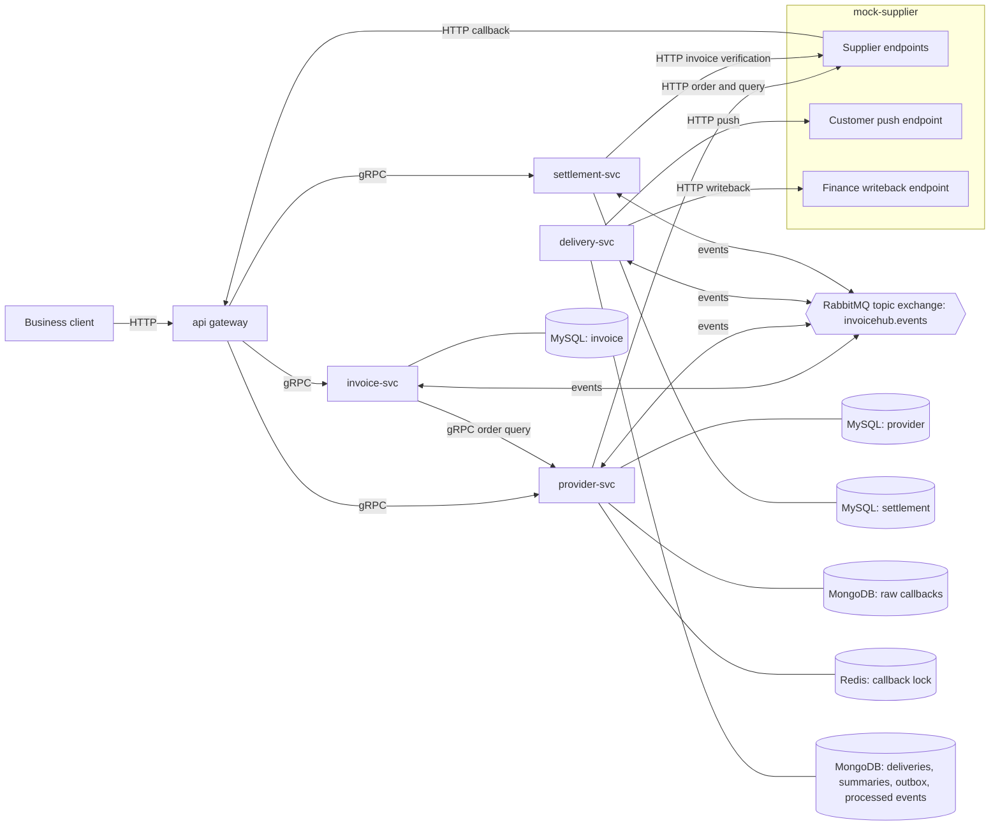

# invoice-hub

invoice-hub is a Go invoice and settlement platform for corporate travel. It coordinates invoice requests for flights, trains, and hotels across suppliers, delivers issued invoices to customers and finance systems, verifies supplier records, and groups invoices into monthly settlements for review and payment. The system separates invoice business state from commands and execution attempts so retries and supplier changes can be tracked independently.

**Status:** Work in progress; end-to-end results will be added once measured.

## Architecture

Five microservices communicate through gRPC and RabbitMQ. A supplier mock also provides customer and finance endpoints for local runs.



Invoice, provider, and settlement each own a MySQL database. Delivery records and raw supplier callbacks occupy separate collections in MongoDB. Delivery transactions require a replica set; the middleware deployment configures a single-node replica set. Redis provides the supplier callback lock.

| Service | Default port | Responsibility |
|---|---|---|
| `api` | 8080 (HTTP) | Invoice requests and queries, supplier callback ingress, and settlement operations through gRPC clients. |
| `invoice-svc` | 9101 (gRPC) | Invoice, command, and task lifecycles; supplier timeout queries and reopening. |
| `provider-svc` | 9102 (gRPC) | Supplier selection, order submission and queries, callback processing, and raw callback capture. |
| `settlement-svc` | 9103 (gRPC) | Monthly settlements, invoice verification, calculation, review, rejection, and payment state. |
| `delivery-svc` | 9104 (HTTP health) | Customer delivery, finance writeback, retry workers, and recovery of stuck deliveries. |
| `mock-supplier` | 8090 (HTTP) | Supplier orders, callbacks, verification data, and simulated customer and finance receivers. |

The defaults come from `internal/platform/config`; `Procfile` starts these six programs. Service addresses can be overridden with `INVHUB_API_ADDR`, `INVHUB_INVOICE_ADDR`, `INVHUB_PROVIDER_ADDR`, `INVHUB_SETTLEMENT_ADDR`, `INVHUB_DELIVERY_ADDR`, and `INVHUB_MOCK_ADDR`.

The normal workflow is request → supplier order → callback → customer delivery and finance writeback → verification and settlement inclusion → invoice closure. Monthly settlements then proceed through calculation, review, and payment. Amounts use fixed-point decimal values, and settlement periods follow the UTC delivery month.

## Reliability mechanisms

The design addresses the following incidents. These are mechanism descriptions, not measured end-to-end guarantees.

| Incident | Failure it would cause | Mechanism |
|---|---|---|
| A client resubmits an invoice request after a network timeout. | The same trip is invoiced twice. | Unique `biz_order_no`; a repeated request returns the existing invoice. |
| A process dies after saving an invoice but before publishing its task event. | The invoice remains in the application state without a supplier order. | Transactional outbox: business data and the event commit together. The MySQL relay design uses `FOR UPDATE SKIP LOCKED`, publisher confirms, and marks an event sent only after confirmation. |
| A relay publishes an event and dies before marking it sent. | Redelivery submits the same supplier task twice. | Per-`event_id` deduplication in `processed_events`, committed with handler effects; a unique `task_id` on supplier orders. |
| A supplier sends the same callback repeatedly. | Repeated state changes trigger repeated delivery. | Three-layer callback dedupe: Redis lock, MySQL state precondition, and a unique raw-callback record on supplier, supplier order number, and event sequence. Raw-record uniqueness deduplicates capture; it does not replace the transactional MySQL guard. |
| Supplier outcomes arrive out of order, including failure followed by success. | A stale failure overwrites an issued order and triggers another invoice. | Monotonic `event_seq`, version compare-and-swap (CAS), and state preconditions. A successful order cannot regress; a newer success may supersede a recorded failure. |
| Delivery completion reaches invoice processing before issuance. | The invoice skips required states or the event is lost. | Transition table + version CAS + state log. Illegal transitions fail processing and enter staircase retry queues: 5s/30s/5m TTL with a dead-letter exchange (DLX), followed by a parking queue when retries are exhausted. |
| A customer processes a push but its response times out. | Retrying creates a duplicate customer record. | At-least-once delivery carries `invoice_id` + `invoice_version` for receiver deduplication; a unique invoice/channel/version key identifies the local delivery record. |
| A delivery worker dies while a record is marked delivering. | The invoice remains stuck, or an old worker overwrites a later attempt. | The fallback retry scanner requeues overdue claims. A fencing token on delivery claims gates completion and retry updates so a worker that lost its claim cannot update it. |
| A supplier never calls back. | The invoice stays in issuance indefinitely. | A timeout scanner queries the supplier first, applies a known outcome, or fails the missing attempt and reopens with another supplier. |
| The same delivered-invoice event is processed twice. | The invoice enters settlement twice and is paid twice. | A unique settlement item per `invoice_id`, with the item and its outbox event in one transaction. |
| A reviewer rejects an incorrect settlement total. | Rebuilding the statement discards its history. | `pending_review → rejected → pending_settle`, followed by recalculation and resubmission; version CAS and the state log preserve the transition history. |
| Supplier invoice data has a different amount, title, status, or no matching record. | Finance pays or books against incorrect or voided invoice data. | Per-product-line verification rules check existence, amount, title, and status; hotel amounts allow ±0.01, while flight and train amounts require an exact match. |
| A service is killed before acknowledging a message. | Work is lost or partially applied again. | Manual acknowledgements and idempotent handlers. Unacknowledged messages are redelivered; retry and parking copies require publisher confirmation before the original is acknowledged. |

Delivery also uses a per-invoice-version summary document in MongoDB against write skew: concurrent customer and finance completions update the same document, forcing conflicting transactions to retry before announcing completion. Delivery outcomes and their outbox events commit together.

Only a settlement in `pending_settle` accepts new items. Late invoices use next-open-period rollover for the same customer, advancing month by month from the UTC delivery month. A missing period is created and opened; totals already under review or paid are not changed by late arrivals.

## Running locally

Prerequisites:

- Go 1.26 on the development machine.
- Docker with Docker Compose on an SSH-accessible host for MySQL, Redis, RabbitMQ, and MongoDB.
- Python 3 on the development machine for the tunnel supervisor, plus Make, Bash, SSH, and tar.
- SSH key access to the middleware host and permission to run Docker there.

From the repository root, create the local configuration:

```sh
cp .env.example .env
```

Edit `.env` with the SSH host, port, user, and middleware credentials. Keep the remote directory from the example, and keep matching passwords consistent across connection URLs and password fields. The deployment script requires random hexadecimal secrets of at least 32 characters.

Start the middleware and prepare the databases:

```sh
make up
make tunnel
make dev-check
make migrate
```

`make up` deploys the middleware to the host configured in `.env`. `make tunnel` starts the supervised SSH tunnels; `make dev-check` checks middleware connectivity. `make migrate` applies the MySQL migrations and MongoDB indexes.

Start the services in a terminal and leave it running:

```sh
make dev
```

In another terminal, run the scenario and reconcile its output:

```sh
make demo
make reconcile SINCE='<started_at from the demo output>'
```

Replace the quoted placeholder with the exact `started_at` timestamp from the demo's JSON output. The default scenario is `scenarios/chaos.yaml`; `scenarios/happy.yaml` provides the normal path. Set `SCENARIO` consistently for `make dev` and `make demo` to select a different file. Reconciliation inspects invoice states, delivery receipts, settlement items, and outbox records.

Stop `make dev` before running the crash scenario, because it launches its own service processes on the same ports. Keep the middleware and tunnels running:

```sh
make crash-demo
```

The crash script kills and restarts service processes during a demo, then runs reconciliation and prints the location of its logs and summary.

Run the test targets with:

```sh
make test
make test-integration
```

Integration tests need the middleware and tunnels. The integration target runs packages serially with `-p 1`.

## Project layout

```text
cmd/             Service entry points, migrations, demo, and reconciliation commands.
internal/        Service domains, application logic, storage, transports, and shared platform code.
proto/           Protobuf service definitions and code-generation configuration.
gen/             Generated gRPC and protobuf Go code.
migrations/      MySQL schemas for invoice, provider, and settlement databases.
deploy/          Middleware Compose configuration and database initialization.
scripts/         Deployment, tunnel supervision, connectivity checks, and crash demo.
scenarios/       Normal-path and fault-injection configurations for the mock.
tools/devcheck/  Standalone middleware connectivity checker used by make dev-check.
Makefile         Development, migration, demo, reconciliation, and test targets.
infra.mk         Middleware deployment and tunnel targets.
Procfile         Local process definitions for the services and mock.
.env.example     Configuration template with placeholder credentials.
```
